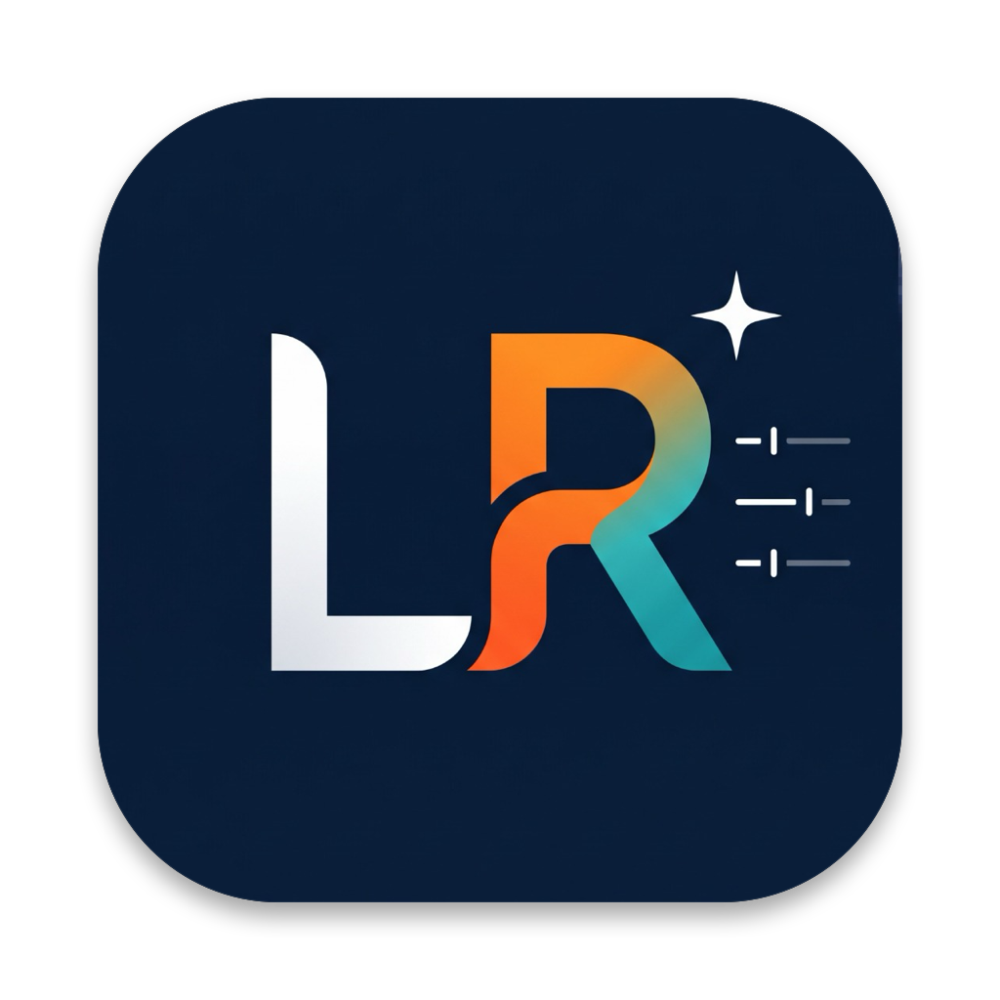

# LightRaw 1.0.0

<p align="center">
  
</p>

<p align="center">
  <strong>Professional 32-Bit Linear RAW Photo Editor & Digital Asset Catalog</strong><br>
  Crafted in Pure Rust with Native GPU Acceleration and Adobe Camera RAW (ACR PV2012) Pipeline Parity.
</p>

<p align="center">
  <a href="#installers--downloads">Download Installers</a> •
  <a href="#features">Features</a> •
  <a href="#building-from-source">Build from Source</a> •
  <a href="#architecture">Architecture</a>
</p>

---

## 🌟 Highlights

* **11-Stage Non-Destructive RAW Pipeline**: 32-bit floating point linear processing matching ACR Process Version 2012 (PV2012), including White Balance, Tone Curves, HSL/Color, Color Grading, Detail/Sharpening with Alt-key mask preview, Lens Corrections, Transform & Upright, Effects (Post-Crop Vignette & Grain), Calibration, and HDR Edit Mode.
* **120 FPS High-DPI UI**: Built on `egui` and `wgpu`/`glow`, maintaining butter-smooth 120 FPS rendering on Apple Silicon ProMotion displays and high-refresh monitors.
* **Synchronized Library Cropping**: Full crop framing, aspect ratio presets, custom ratio locks, and straightening angle synchronization across individual photos, multi-selections, or the entire catalog.
* **Contact Sheet & Fine Art Printing**: Multi-row/multi-column grid layouts, Picture Package, Custom Package, bleed guides, cut marks, custom margin controls, 300 PPI export to PDF/JPEG, and direct macOS printer integration.
* **SQLite Asset Catalog**: Fast, durable `.lrcat` catalog storing image metadata, development history, virtual copies, collections, star ratings, color labels, and pick flags.
* **Apple Silicon & Hardware Acceleration**: Integrated with Apple Neural Engine (ANE) and Metal for subject segmentation, facial feature detection, and depth map extraction, with automatic pure-Rust vector SIMD fallbacks on Windows and Linux.

---

## 📦 Installers & Downloads

Pre-built binaries and installers are provided for every major platform in [GitHub Releases](https://github.com/moestret/LightRaw/releases):

| Platform | Installer Type | File Name | Notes |
| :--- | :--- | :--- | :--- |
| **macOS** | Disk Image (`.dmg`) | `LightRaw-1.0.0-macOS.dmg` | Drag & Drop to `/Applications` |
| **Windows** | Setup Executable (`.exe`) | `LightRaw-1.0.0-Windows-Setup.exe` | Inno Setup with file associations |
| **Windows** | Windows Installer (`.msi`) | `LightRaw-1.0.0.msi` | Enterprise WiX package |
| **Linux** | Debian Package (`.deb`) | `lightraw_1.0.0_amd64.deb` | Ubuntu, Debian, Linux Mint, Pop!_OS |
| **Linux** | Universal AppImage | `LightRaw-1.0.0-x86_64.AppImage` | Portable binary for any Linux distro |
| **Linux** | Compressed Tarball | `lightraw-1.0.0-linux-x86_64.tar.gz` | Standalone archive with desktop entry |

---

## 🛠️ Building from Source

### Prerequisites
* [Rust toolchain](https://rustup.rs/) (1.75 or newer)
* On Linux:
  ```bash
  sudo apt-get install -y libssl-dev libx11-dev libxcursor-dev libxrandr-dev libxi-dev libfontconfig1-dev libgl1-mesa-dev
  ```
* On macOS: Xcode Command Line Tools (`xcode-select --install`)

### Build & Run
```bash
# Clone the repository
git clone https://github.com/moestret/LightRaw.git
cd LightRaw

# Build optimized release binary
cargo build --release

# Run LightRaw
cargo run --release
```

### Run Automated Test Suite
```bash
cargo test
```

---

## 📐 Packaging Installers Locally

* **macOS DMG**:
  ```bash
  ./packaging/macos/build_dmg.sh
  ```
* **Linux Debian Package**:
  ```bash
  ./packaging/linux/build_deb.sh
  ```
* **Linux AppImage**:
  ```bash
  ./packaging/linux/build_appimage.sh
  ```

---

## 📄 License & Attribution

Copyright © 2026 Moestret. All rights reserved.
Developed independently in Rust with native platform frameworks.
